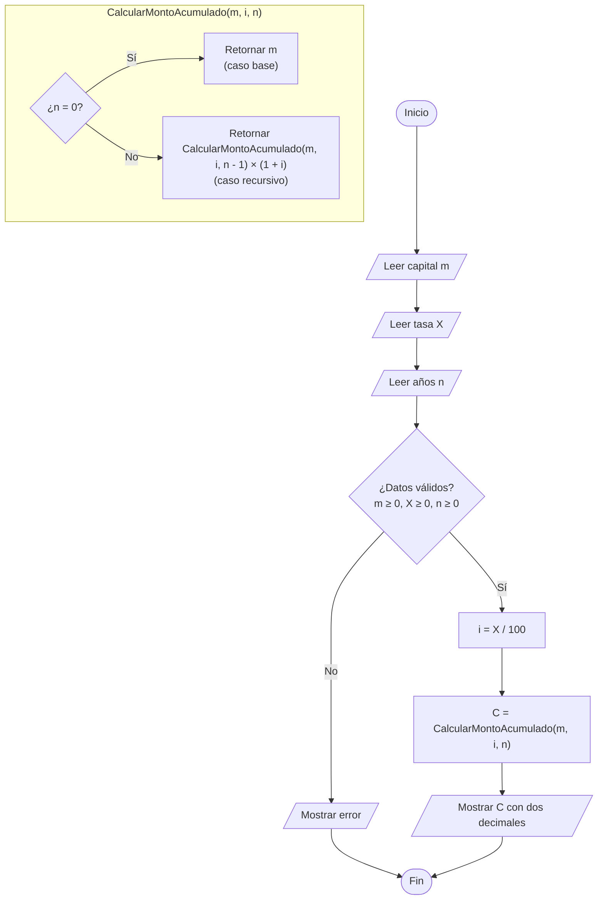
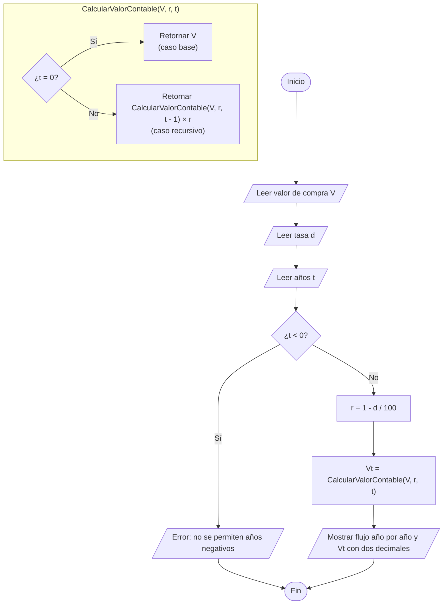

# Práctica sobre recursividad

Dos programas de consola en C# (.NET 10) que resuelven cálculos financieros usando
**únicamente funciones recursivas** (sin `for` ni `while`).

| Proyecto | Descripción |
|---|---|
| `Problema1InteresCompuesto` | Monto acumulado de una inversión con interés compuesto anual. |
| `Problema2Depreciacion` | Valor contable de un activo con depreciación por saldo decreciente. |

## Cómo ejecutar

```bash
dotnet run --project Problema1InteresCompuesto
dotnet run --project Problema2Depreciacion
```

Los decimales se escriben con punto (`1500.50`), según la configuración regional del equipo.

---

## Problema 1: Interés compuesto recursivo

### Variables

| Variable | Descripción | Tipo |
|---|---|---|
| `m` | Capital inicial depositado | `decimal` |
| `X` | Tasa de interés anual (%) | `decimal` |
| `i` | Interés en factor (`X / 100`) | `decimal` (calculado) |
| `n` | Tiempo de la inversión en años | `int` (≥ 0) |
| `C(n)` | Monto acumulado después de `n` años | `decimal` (salida) |

### Lógica recursiva

- **Caso base** (`n = 0`): `C(0) = m`
- **Caso recursivo** (`n > 0`): `C(n) = C(n - 1) × (1 + i)`

### Diagrama de flujo



### Ejemplo

Capital `$1,000`, tasa `10%`, `2` años:

- C(0) = 1,000.00
- C(1) = 1,000.00 × 1.10 = 1,100.00
- C(2) = 1,100.00 × 1.10 = **1,210.00**

---

## Problema 2: Depreciación por saldo decreciente

### Variables

| Variable | Descripción | Tipo |
|---|---|---|
| `V` | Valor de compra original | `decimal` |
| `d` | Tasa de depreciación anual (%) | `decimal` (0 a 100) |
| `r` | Factor de retención (`1 - d / 100`) | `decimal` (calculado) |
| `t` | Años de vida útil transcurridos | `int` (≥ 0) |
| `V(t)` | Valor contable al final del año `t` | `decimal` (salida) |

### Lógica recursiva

- **Caso base** (`t = 0`): `V(0) = V`
- **Caso recursivo** (`t > 0`): `V(t) = V(t - 1) × r`

### Diagrama de flujo



### Ejemplo

Laptop de `$1,000` con depreciación de `20%` anual:

- Año 0: $1,000.00 (caso base)
- Año 1: $800.00
- Año 2: $640.00
- Año 3: **$512.00**
